# bean

Keep your health record as a folder that you own. Every lab result, reading, meal, symptom and note is a small signed file. You can copy the folder anywhere, check it without a server, and let an AI or a doctor read it on your terms. You can compare a reading with public survey data, and share chosen records in a form that anyone can check.

```
$ bean add symptom.headache 7 -unit '{score}' -note "after a salty lunch"
sha256:1b59a10ca53607dac3516c7a8c8798b34597b54f97b704075cd00217c2ecee29
$ bean ls -since 2026-10-01
2026-10-24 15:00  symptom.headache  7 {score}  # after a salty lunch   1b59a10ca536
2026-10-27        weight            81.2 kg                            31fe480169a8
2026-10-28 13:00  food              ramen, extra broth    [assistant]  f21a3641fc82
```

This repository is the reference implementation of the **bean** protocol: [CORE.md](CORE.md) in short, [SPEC.md](SPEC.md) in full. The command is `bean`.

> **Status: pre-release.** The record format is a draft. It freezes at `v` 0 after two weeks of real use with no change to [CORE.md](CORE.md). Until then, keep your source files (PDFs, exports), so that you can import them again if the format changes.

New here: [docs/ONBOARDING.md](docs/ONBOARDING.md) goes from install to an imported lab report, an AI assistant, a backup and a tested exit. It has rules to give an AI that helps you.

## Principles

- **You own the folder.** No account, no server, no company in the middle. Copy it, back it up, delete it.
- **Every record is a claim, not a fact.** A lab result, a watch reading and "headache 7/10" each have an author, a time and a source.
- **Nothing is edited.** A correction is a new record that replaces the old one. A deletion is a record that every copy obeys.
- **Signatures, not trust.** Every record is signed and named by its hash. `bean verify` finds any change.
- **You outlive your keys.** 24 words on paper recover your identity on a new machine and retire a lost key.
- **Leave at any time.** `bean export` writes every record that you did not delete, and your stored files, as plaintext. `bean restore -export` reads it back. An export holds no key file, no package and no reference pack: [keep those yourself](#backups-and-a-lost-laptop).

## How it works

```mermaid
flowchart TB
    subgraph public["Public data"]
        direction LR
        source["A source,<br/>such as a survey"] -->|"a builder that<br/>anyone can run"| pack["A reference pack:<br/>one file, named<br/>by its SHA-256"]
        pack --> host["Any host: a web server,<br/>a Blossom server,<br/>a friend's disk"]
    end
    subgraph machine["Your machine"]
        direction LR
        bean["bean"] -->|"signs, stores, reads"| log["Your log:<br/>signed records<br/>in one folder"]
    end
    peer["A peer or a doctor"]
    public -->|"the whole pack, checked by its SHA-256"| machine
    machine -->|"a sealed file of the records<br/>that you chose, and<br/>six words"| peer
    peer -->|"signed notes in reply"| machine
```



Your data stays in your folder. You share chosen records with one person at a time. To compare, public data comes to your machine whole, and your reading never leaves. [docs/ARCHITECTURE.md](docs/ARCHITECTURE.md) has the three parts as pictures, with what works today and what is planned.

## Try it in five minutes

One script runs the whole loop on a synthetic lab report, in a throwaway folder. It imports the report, fetches public survey data from the US CDC, compares, and shares. Then it checks the result without bean.

```
git clone https://github.com/Conscious-Repository/bean.git
cd bean
examples/blood/run.sh
```

It needs Go and `curl`, and downloads about 7 MB from CDC. With Python and `pip install -r tools/requirements.txt` it also runs the checks that use no bean. [examples/blood](examples/blood/README.md) walks through what it does.

## Install

| You need | For | Install on macOS |
|---|---|---|
| Go 1.24 or later | Building `bean`. On the first build, Go downloads the toolchain that `go.mod` names (go1.27.3). | `brew install go` |
| `pdftotext` | Lab report PDFs only | `brew install poppler` |
| `make` | `make page`, the page that checks a bundle in a browser | It comes with Xcode's command line tools |
| Python 3 | Optional: the checks that use no bean (`tools/second`, `tools/compare`) | `brew install python`, then `pip install -r tools/requirements.txt` |

Build and install the commands. One line installs the newest release, with no copy of the code:

```
go install github.com/Conscious-Repository/bean/cmd/...@latest
```

`bean version` then names the release. To work on the code, or to run the newest `main`, clone it. For a release in a clone, run `git checkout <tag>` before `go install`: the [releases](https://github.com/Conscious-Repository/bean/releases) list the tags.

```
git clone https://github.com/Conscious-Repository/bean.git
cd bean
go install ./cmd/...
```

This puts `bean`, `bean-import-lab`, `bean-import-apple-health`, `bean-import-csv`, `bean-import-nhanes` and `bean-pack-nhanes` in `$(go env GOPATH)/bin`, usually `~/go/bin`. If your shell cannot find `bean`, add that folder to your `PATH`:

```
echo 'export PATH="$PATH:$(go env GOPATH)/bin"' >> ~/.zshrc && source ~/.zshrc
bean version
```

If the build fails with `package crypto/hkdf is not in GOROOT`, your Go is too old. Check with `go version`.

## Quick start

1. Choose a folder for your log and tell `bean` about it:

   ```
   echo 'export BEAN_DIR=~/health' >> ~/.zshrc && source ~/.zshrc
   ```

2. Create your identity. Run this yourself, in a terminal that no AI assistant reads: it prints your recovery words.

   ```
   bean init -nostr new
   ```

   It prints your identity, your npub and 24 words, and says where the log is. **Write the 24 words on paper now.** `bean` shows them only once. They recover your identity on a new machine. Never type them into a chat, an AI or a crypto wallet. Write your identity id (the `sha256:...` on the first line) on the same paper. It is not secret. `restore -identity` needs it if someone puts a copy of your public commitment in the folder.

3. Add something:

   ```
   bean add weight 81.2 -unit kg
   bean add symptom.headache 7 -unit '{score}' -note "after a salty lunch"
   ```

4. Read it back and check it:

   ```
   bean ls
   bean verify
   ```

   The `verify` count includes your identity record.

Without `-nostr new`, `init` makes an Ed25519 key instead of a Nostr key. `-nostr <file>` uses a Nostr secret key that you already have. A separate npub for your health log is the safer choice. The secret key is stored on this machine. A key that you replace can never sign this log again.

## Everyday use

Add a record with a type and a value. A number with a unit can be averaged later. Text keeps your words.

```
bean add food "2 eggs, sourdough, coffee" -note breakfast
bean add drink.water 0.5 -unit L
bean add supplement "magnesium glycinate" -note "400 mg"
bean add exercise.run 5 -unit km -at "2026-10-28 07:15"
bean add note "drank 1 L of water, gone by 5 pm" -about 1b59a1   # 1b59a1: the start of an id that bean printed for you
bean add food "toast" -photo breakfast.jpg
```

- `-at` says when it happened. Without it, the time is now, also for a correction: give `-corrects` the old record's time with `-at`.
- `-about <id>` attaches a record to another one. An id can be shortened to its first 6 or more hex digits.
- `-photo` attaches an image, stored encrypted.
- The [type vocabulary](cmd/bean/vocabulary.md) lists the usual types and units, so that your records line up over time. To add types of your own, put a `vocabulary.md` in your bean folder ([Your own types](cmd/bean/vocabulary.md#your-own-types)).

Find things:

```
bean ls -type food -since 2026-10-01      # one type, from a date
bean ls -type 'lab.*'                     # every lab result; flags show as High or Low
bean show 1b59a1                          # one record, its status and its replies
bean ls -json -type weight                # records as stored, for jq or a script
```

Correct or delete:

```
bean add weight 81.2 -unit kg -corrects 31fe48 -at 2026-10-27   # replaces your record 31fe48
bean purge 1b59a1                                               # deletes record 1b59a1 from every copy
```

## Import your data

Each source has an importer: a separate program, `bean-import-<name>`, that `bean import <name>` runs. Anyone can write one for their own source, in any language. [docs/IMPORTERS.md](docs/IMPORTERS.md) has the contract and a list of community importers.

### Lab reports (PDF)

bean reads lab report PDFs in the layouts it knows. Today: the Labcorp patient report and the Quest Diagnostics report. Any other layout is refused, and nothing is written. Import yours:

```
bean import lab -tz America/Chicago lab-result.pdf
```

bean shows what it read and asks before it saves: compare it with the PDF, then type `y`. `-yes` skips the review, for scripts. Without a terminal and without `-yes` it writes nothing and shows no value, so an AI assistant cannot import for you unseen.

bean keeps the PDF first, encrypted, as a `lab.report` record, and checks that it reads back. Then you get one record for each result, with the value, unit, flag, reference interval, panel and lab comments. Your name, birth date and patient ids are not copied into the results; the PDF keeps everything.

- `-tz` is the zone where the sample was taken: `America/New_York`, `America/Chicago`, `America/Denver`, `America/Los_Angeles`. Not `CST`. Without it, only the day is recorded. If the report says the collection time was not given, only the day is recorded too. A Quest report prints its zone, so it needs no `-tz`; one that disagrees with the printed zone is refused.
- The first output line names the record that keeps the PDF: `kept lab.report <id>: file sha256 <hash>, stored as <blob id>`. `bean purge <id>` erases the PDF.
- Import the same file again and nothing is added. A later report can change a value: for example, a final result replaces `Pending`. Then the new PDF is kept, but `bean import` names the reading, writes nothing for it, and exits 1. If the report is newer and right, run it again with `-corrections`.
- The importer reads the text layout (Labcorp) or each word's position (Quest). It refuses any line it cannot read for sure. Then none of the values is written, and the file is kept all the same, encrypted. bean says why nothing was read, with the line, or the page and how far down it is. That line can hold one of your values: do not paste it publicly ([how to send counts in its place](docs/ONBOARDING.md#if-no-reading-was-read)).
- A `.txt` made with `pdftotext -layout` works too, for Labcorp. A Quest report is read by where each word is printed: give the PDF, or the `.html` that `pdftotext -bbox-layout` makes.

Readings name the PDF by its SHA-256, not as a blob, so purging the `lab.report` erases the PDF. Readings from importers before 0.2.0 still name the PDF; purge them too. See [the importer notes](cmd/bean-import-lab/README.md).

### Apple Health

On the iPhone, Health, your picture, Export All Health Data. Then:

```
bean import apple-health export.zip              # keeps the export, encrypted; asks first
bean import apple-health -records export.zip     # also one record per reading
```

The export has no sample ids, so bean cannot tell a changed reading in a later export from a new one. Nothing is summed per day. Apple writes a percentage as a fraction, so walking double support 0.272 is stored with unit `1`: it means 27.2%. Blood pressure and food readings sit in Correlations; they stay in the file and are not read. `bean purge` of the `apple-health.export` erases the file. See [the importer notes](cmd/bean-import-apple-health/README.md).

### A CSV file

```
bean import csv -type hrv.rmssd -unit ms export.csv
```

The CSV needs a header row and a `value` column. A `time` column (RFC 3339) and an `id` column are optional. Other columns are kept as context. The file is kept first, so a better importer can read it again later. [docs/COMMANDS.md](docs/COMMANDS.md) lists what the CSV importer refuses.

## Compare with people like you

`bean compare` shows where a reading lies among people you describe, in public survey data (NHANES, from the US CDC). You say who: sex, age, and if you like ethnicity, BMI, or what they ate that day. It runs on your machine, on files you downloaded and keep.

```
mkdir ~/nhanes && cd ~/nhanes        # a folder of its own, not the bean folder
for f in DEMO_J TCHOL_J HDL_J GHB_J CBC_J BIOPRO_J FERTIN_J BMX_J; do
  curl -fLO https://wwwn.cdc.gov/Nchs/Data/Nhanes/Public/2017/DataFiles/$f.xpt && bean import -yes nhanes $f.xpt
done
bean add lab.cholesterol-total 187 -unit mg/dL      # a reading, if you imported no lab report
bean compare -sex male -age 30-39 -type 'lab.*'
bean compare -sex male -age 30-39 -where DEMO_J.RIDRETH3=3 -where BMX_J.BMXBMI=20-27 -type 'lab.*'
```

Type the name and the unit as COMPARE.md lists them: `mg/dl` is not `mg/dL`, and gets no number.

```
Compared with NHANES 2017-2018: male, age 30-39.
DATE              READING                VALUE      PERCENTILE  LOWER  SAME  MIDDLE HALF  MEDIAN  N    NOTE  ID
2026-11-03 08:53  lab.cholesterol-total  187 mg/dL  46          44.2%  3.5%  164 to 213   188     339        fca23ea91778
```

- It says where a value lies in a sample, and how many people the sample has. It does not say whether a value is healthy, and it does not advise.
- Every number comes with its caveats and with how many people it rests on. A cohort of fewer than 30 people gives no number.
- `-save` keeps a result as a signed record that names each file by its SHA-256, the cohort and the method. Anyone can compute it again without bean: `tools/compare/reproduce.py` does, in Python.
- Nineteen blood tests today: total and HDL cholesterol, hemoglobin A1c, the blood count, six tests of the biochemistry profile, and ferritin. Each test needs its own file, and a rule on BMI needs `BMX_J`: the loop above fetches all eight, about 9 MB. [COMPARE.md](docs/COMPARE.md) lists the type names and units to use when you type a reading by hand.

- **A reference pack is the general form.** A pack is one small file of public reference data, with a table for each measure and each cohort on its menu. `bean-pack-nhanes -out nhanes.pack *.xpt`, in the folder of the downloads, builds one from them, with weight beside the blood tests. A measure is one quantity that the source measured, such as total cholesterol. `bean compare -pack nhanes.pack -cohort male-30-39 -type 'lab.*'` compares with it. Keep the pack file: your log names it by its SHA-256 and does not hold it. The table comes to your value, so no host learns the value or the cohort. Any source that someone builds into a pack works the same way.

[docs/COMPARE.md](docs/COMPARE.md) has the files to download, the rules, the limits and the method. [docs/REFERENCE.md](docs/REFERENCE.md) has the pack format, who hosts what, and how anyone checks a pack.

## Share with someone

`bean share` writes records you choose into a bundle that anyone can check without your log, your keys or an account. With `-seal` the bundle is one encrypted file that opens with six words: send the file one way and give the words another.

```
bean share -seal -out for-ana.bean -note "my lipids" -type 'comparison.*'
bean check-bundle for-ana.bean     # what Ana runs: it asks for the six words, checks, then shows what it holds
```

Two people who both run bean can share with no words read out. The reader makes a key file once with `bean address`, and gives its address to the sender. `bean share -for <address>` seals a package to it, and `bean check-bundle -key <file>` opens it. A reply goes back the same way: `bean reply -for`, and `bean accept -key`. [docs/SHARE.md](docs/SHARE.md) says what that costs: a key file to guard, and no call that says which share a package is.

- It shows what will leave and asks first. Only the records you choose go, with what they are about. Files go only with `-files`, and a lab report only when you name it.
- The reader can tell that each record is yours and unchanged, and that nothing was added or removed. They can check it without bean: `tools/second/checkbundle.py`.
- A reader who runs bean can answer. `bean reply` signs notes about the records that you shared. `bean accept` shows the reader's identity words, and takes the notes into your log under a name that you give. Only notes about what you shared can come in.
- A reader with no terminal checks it in a browser, with `bean-check.html`: one file that reads the folder or a zip file of it. Each [release](https://github.com/Conscious-Repository/bean/releases) has the page with its SHA-256, and `make page` builds the same file. The page runs the same check on the reader's device and sends nothing. It shows the signer as eight identity words, which you read to your reader (`bean whoami`). They are not the six words that open the package: those are a secret, and these are not. It lists each file that the bundle carries, to read or to save.
- The reader cannot tell that it is complete: it is what you chose. Nor that the key that signed is still yours, if you changed keys since. bean says so on every check.
- Without `-seal` a bundle is a plain folder that anyone who carries it can read. Sealed or not, once it is opened it cannot be taken back.

[docs/SHARE.md](docs/SHARE.md) has what goes in, the limits and the format.

## Log from an AI assistant

`bean mcp` is a [Model Context Protocol](https://modelcontextprotocol.io) server. Any AI client that supports MCP can use it to read your log, and to add to it if you let it.

| Command | The assistant can |
|---|---|
| `bean mcp` | List types, query and summarize records, read one record. |
| `bean mcp -write -label assistant` | Also log entries, signed with this machine's agent key. |
| `bean mcp -blobs` | Also read stored text files, such as a report imported as `.txt`, with your name and birth date. A PDF gives only its size. |

Start read-only. AI clients do not read your shell profile: use absolute paths, not `~` or `BEAN_DIR`.

Claude Code:

```
claude mcp add -s user bean -- "$(which bean)" -dir "$HOME/health" mcp
```

Claude Desktop, in `~/Library/Application Support/Claude/claude_desktop_config.json`, then restart it:

```json
{"mcpServers": {"bean": {"command": "/Users/you/go/bin/bean", "args": ["-dir", "/Users/you/health", "mcp"]}}}
```

Other clients take the same command and arguments as a stdio server.

With `-write`, tell the assistant what happened, for example "had ramen with extra broth around 1" or "took 400 mg magnesium". You can also ask questions: "is my resting heart rate going up this month?" The assistant logs your words with the correct type and time. It puts a calorie or sodium estimate in a separate record that points to the meal. Your words do not change. Its records show as `[assistant]` in `bean ls`.

The assistant signs with its own **agent key**, not your key. It can add records about you. It cannot correct or delete your records, sign as you, or write lab results: those come only from an importer that keeps the source file. It can log only the types in the vocabulary and in your own `vocabulary.md`, if you have one. One machine has one agent key, so every assistant on it signs as the same agent, under one label. Pick a label that fits them all, such as `assistant`. bean refuses a second label for that key: it would show one assistant's records under another's name. To tell two assistants apart, run one on another machine ([below](#run-an-agent-on-another-machine)).

The server sends the records it returns to the AI provider. Use a local model if that is a problem for you.

## More than one machine

Only `objects/` and `blobs/` are the log. `local/` holds the keys of one machine: never sync it.

### Keep two copies the same

On one machine, with the other copy mounted or copied to a folder:

```
bean sync /path/to/other/copy
```

Over the network, copy with rsync, then check:

```
rsync -a ~/health/objects ~/health/blobs server:health/
ssh server '~/go/bin/bean -dir ~/health verify'
rsync -a server:health/objects server:health/blobs ~/health/
bean verify
```

Sync only from your own copies: `bean sync` copies every record file of the source. Never use `rsync --delete`: the log only grows, and deletions travel as records. Syncthing also works if you share `objects/` and `blobs/` only. Run `bean verify` after a copy made with another tool; it applies deletions that came with the copy.

Each machine needs its own folder. Do not point two machines at one shared or network folder: the folder lock works only inside one machine ([SECURITY.md](SECURITY.md)).

### Run an agent on another machine

For example, an assistant on a cloud server. The server gets a copy of the log and its own agent key, but not your key and not your 24 words.

1. Copy `objects/` and `blobs/` to the server, as above.
2. On the server, make the agent key:

   ```
   bean -dir ~/health agent init -label server
   ```

   It prints the agent's npub and the command for the next step.
3. On your own machine, trust the agent:

   ```
   bean agent pair npub1... -label server
   ```

4. The agent logs with `bean add -agent ...`, `bean append -agent`, or `bean mcp -write`. Sync both ways as above. Its records show as `[server]`.

Anyone who can read the server's folder can read your records: they are plain JSON. Photos and other stored files stay encrypted unless you also copy `local/identity-secret` to the server.

### Backups and a lost laptop

Any copy of `objects/` and `blobs/` is a backup: Time Machine, a drive, another machine. The 24 words rebuild the keys in `local/`. Also back up `local/purged-refs.jsonl`: it is the only record of which imports you deleted. Without it, importing the same source data again brings deleted readings back ([SECURITY.md](SECURITY.md)).

A backup is a copy of the log. An export is plain files for leaving; `bean restore -export` turns one back into a log ([ONBOARDING](docs/ONBOARDING.md#7-leave-and-come-back)).

**What a backup and an export do not hold.** Keep each of these yourself.

- **A key file from `bean address`.** It is outside the log, and the 24 words do not bring it back. Without it, no package that was sealed to its address opens again. bean does not encrypt a key file, so keep it as any secret key is kept ([SECURITY.md](SECURITY.md), [docs/SHARE.md](docs/SHARE.md#seal-it-to-a-readers-address)).
- **A package or a bundle that you sent or received.** It is a file or a folder outside the log.
- **A reference pack.** A saved comparison names its pack by a SHA-256, and nobody computes that comparison again without the file.
- **What an export leaves out of the log.** The records that you deleted, and the files of `local/`, which [docs/COMMANDS.md](docs/COMMANDS.md#files-in-a-log-folder) lists. `manifest.json` in an export lists what bean did not write, and why.

If you lose the laptop:

1. Install `bean` on the new machine.
2. Copy every backup and copy that you still have into one folder:

   ```
   mkdir -p ~/health && cp -R /Volumes/Backup/health/objects /Volumes/Backup/health/blobs ~/health/
   ```

3. Rebuild `local/` and move to a new signing key. Run it yourself: it reads your 24 words.

   ```
   bean -dir ~/health restore -nostr new
   ```

   It shows what the old key signed and stops. Read the list. **If nobody else had the old key,** run it again with `-seal-all`, type the 24 words, and press Ctrl-D. Then clear the terminal and its scrollback (Cmd-K). **If the key may be stolen,** add `-no-seal <id>` for each record that is not yours, or `-no-seal-file <file>` for many. `-list` shows every record. A record you keep stays valid for good, and you cannot undo a deletion you keep.

4. Put back your backup of the deleted-imports file:

   ```
   cp /Volumes/Backup/health/local/purged-refs.jsonl ~/health/local/
   ```

Your identity and records stay the same. The lost key can no longer add, correct or delete anything: a record it signs after the rotation is not valid. Records of the old key that you keep stay valid, because the rotation seals them. Use `bean rotate` the same way on a machine that you still have, for example when a key is old.

If `restore` says `ambiguous`, the folder holds more than one identity made from these words' public commitment (someone can copy it). Pass your identity id: `bean -dir ~/health restore -identity sha256:...`. Your identity id is on the first line that `init` printed, in any export's `manifest.json`, and in `bean whoami` on an old machine.

Sync every copy before you rotate or restore, then check what the sync brought in. `bean rotate` works the same way as `restore`: without `-seal-all` it only shows the list. Records that a copy made with the old key and did not sync before the rotation stop being valid. A log of more than 200,000 records per key rotates into a succession plus `seal part` records; copy all of them. Until every part is in a copy, `bean verify` there says `incomplete seals` and the old key's records do not count, but nothing is deleted.

**Never rotate or restore on two machines from the same point.** That freezes the identity for good. `bean migrate <empty folder>` then starts a new identity with your own records.

### Upgrading

Read [UPGRADING.md](UPGRADING.md) before you run a new build on your log. It lists the changes that alter results, and how to try a new build on a copy first.

## Under the hood

A record is a JSON file in `objects/`, named by the SHA-256 hash of its content and signed with your key. Your identity is the hash of your first record, so it never changes when keys change. Corrections and deletions are new records. The protocol says who may make them, so every copy reaches the same result from the same files. Stored files (PDFs, photos) are encrypted in `blobs/`. Sync copies the files that one copy has and the other does not.

Every record is checked when it is first read, then cached, the same way git trusts its object store. `bean verify` checks everything again. At 20,000 records, `add` and an AI query take under 1 s and `verify` about 1.3 s (4-core Linux virtual machine, measured 2026-11-10). At 230,000 records on one machine (measured 2026-10-30), `add` takes about 7 s, `verify` about 11 s and `rotate` about 9 s. Each needs about 2.5 GB of memory. Every write goes to disk before it counts.

[CORE.md](CORE.md) is a short summary of the protocol. [SPEC.md](SPEC.md) has every rule: enough to write a second implementation.

## Security

bean protects who wrote what, and protects your identity against a stolen device. It does not hide your records from someone who can read the folder: keep the log on an encrypted disk. [SECURITY.md](SECURITY.md) lists what is and is not protected, where each key lives, and how to report a problem.

## Documentation

| Document | For |
|---|---|
| [docs/ARCHITECTURE.md](docs/ARCHITECTURE.md) | The whole of bean in three pictures: your machine, a share with one person, a comparison with public data. |
| [docs/ONBOARDING.md](docs/ONBOARDING.md) | First run, step by step, alone or with an AI. |
| [docs/COMMANDS.md](docs/COMMANDS.md) | Every command, flag and exit code. |
| [docs/IMPORTERS.md](docs/IMPORTERS.md) | Write an importer for your own source; community importers. |
| [docs/COMPARE.md](docs/COMPARE.md) | Compare a reading with people like you: files, rules, limits, method. |
| [docs/REFERENCE.md](docs/REFERENCE.md) | Reference packs: public data as one file, its format, who hosts what, and the checks. |
| [docs/REFERENCE-PLAN.md](docs/REFERENCE-PLAN.md) | What is decided for reference data before more is built, with the facts that were measured. |
| [docs/SHARE.md](docs/SHARE.md) | Share chosen records as a bundle anyone can check: what goes in, limits, format. |
| [docs/SHARE-PLAN.md](docs/SHARE-PLAN.md) | A seal to a reader's key: what was decided before it was built, what is built, and what it costs. |
| [examples/blood](examples/blood/README.md) | The whole loop in one script, on a synthetic report. |
| [cmd/bean/vocabulary.md](cmd/bean/vocabulary.md) | The usual record types and units. |
| Importer notes: [lab](cmd/bean-import-lab/README.md), [Apple Health](cmd/bean-import-apple-health/README.md), [NHANES](cmd/bean-import-nhanes/README.md) | What each importer reads, keeps and refuses. |
| [SECURITY.md](SECURITY.md) | What is protected, and the keys. |
| [CORE.md](CORE.md) | The protocol, in short. |
| [UPGRADING.md](UPGRADING.md) | Changes that alter results for an existing log. |
| [SPEC.md](SPEC.md) | The full protocol: every rule, error and conformance test. |
| [docs/ROADMAP.md](docs/ROADMAP.md) | The open paths: what comes next, in what order, and what is not decided. |
| [docs/DECISIONS.md](docs/DECISIONS.md) | Every design decision, numbered, with the reason. |
| [docs/DEVICE.md](docs/DEVICE.md) | For the people who build an instrument: what a device signs and how it hands it over. A draft. |
| [docs/EXTENSIONS.md](docs/EXTENSIONS.md) | Two draft extensions that no code implements yet: computed results and device capture. |
| [docs/PROVIDER-INGESTION.md](docs/PROVIDER-INGESTION.md) | How data from a provider gets in, one source at a time. |
| [docs/GOVERNANCE-PROPOSAL.md](docs/GOVERNANCE-PROPOSAL.md) | A proposal for who decides changes to the protocol. Not decided. |
| [tools/second/README.md](tools/second/README.md) | The second verifier, in Python, written from the documents alone. |
| [CONTRIBUTING.md](CONTRIBUTING.md) | Build, test and change the code. |

## License

The specification text is CC0 1.0 ([LICENSE-SPEC](LICENSE-SPEC)). The code is Apache-2.0 ([LICENSE](LICENSE)).
