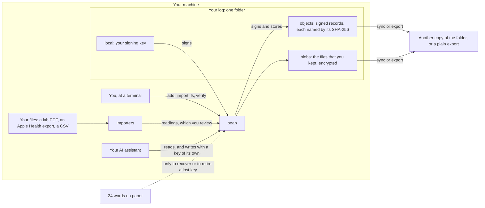
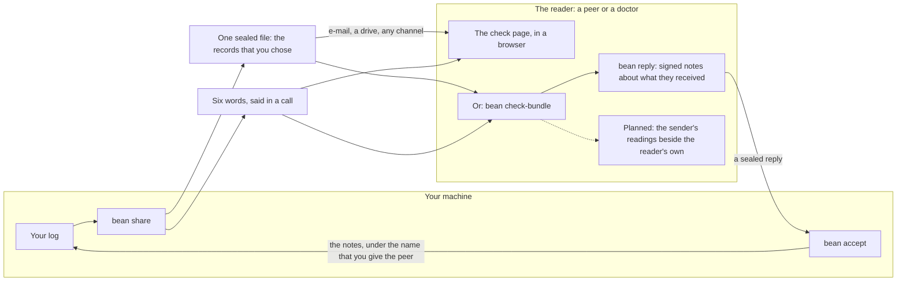
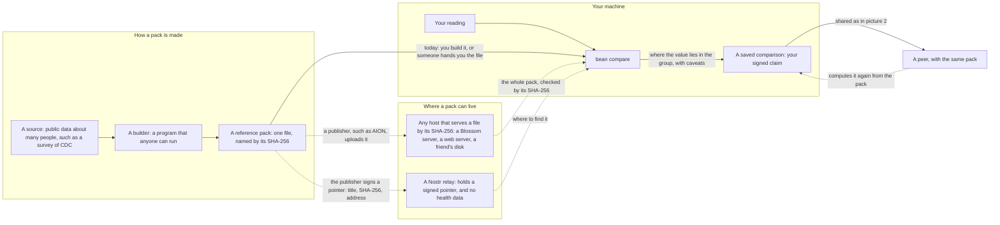

# How bean works, in three pictures

This is for anyone who wants the whole of bean in one view. It shows where your data lives, how you share it with one person, and how you compare it with public data. Each picture has the parts that work today as solid lines. A dashed line is a part that is planned and not built.

bean is not a diagnosing tool. Nothing in these pictures says whether a value is healthy.

## 1. On your machine

Your log is one folder. bean signs each record with a key that stays on your machine, and names the record by the SHA-256 of its content. No server and no account are part of it.

- A record is a claim with an author, a time and a source. It is never edited: a correction is a new record.
- The signing key in `local` is not copied by a sync. The 24 words are on paper, and never on a device.
- A record that your assistant writes is signed by the assistant's key, and shows as the assistant's.
- `bean verify` checks every record again. `bean export` writes everything as plain files, so that you can leave.

## 2. Share with one person

You choose records, and bean packs them into one sealed file. The file goes by any channel. Six words open it, and they go by another channel, such as a phone call.

- The reader needs no key and no account. The check runs on their device and sends nothing.
- The check shows who signed, as eight identity words that you read out in the same call.
- A check proves who signed a record and that nobody changed it. It does not prove that a record is true.
- A reader who has opened the file holds a copy for good.
- A peer's records are never mixed into your log. Only their signed notes come in, under a name that you choose.

## 3. Compare with public data

A reference pack is one file of public data: a table for each measure and each group of people. The pack comes to your machine whole, and the arithmetic is done there. Your reading never leaves, and nobody learns which group you chose.

- **A pack is what its SHA-256 says.** A host cannot change it without the check failing. So no host needs to be trusted, and any person can host a pack for a friend.
- **A pointer is not the data.** A publisher signs a short note: the title of the pack, its SHA-256 and where it is. A relay holds that note. The note helps you find a pack. It never makes a pack right.
- **What a host learns:** that someone fetched a pack. It learns no reading and no group, because the pack is fetched whole.
- **Who says that a pack is right.** bean holds the SHA-256 of the packs that it has on record. Two programs that share no code build those bytes from the source's files. For any other pack, bean says that nobody has checked it.
- **A saved comparison is your claim.** It names the reading, the pack, the group and the method. A peer with the pack can do the arithmetic again. That shows that the numbers hold, not that the reading is true.
- **Today** a person builds a pack from the source's files, or gets the file from someone. Packs on a host, and pointers on a relay, are the next step ([ROADMAP.md](ROADMAP.md)).

## The words

| Word | Meaning |
|---|---|
| Log | Your folder of signed records. |
| Record | One signed file: a reading, a note, a kept file, or one of bean's own. |
| Bundle | The records that you chose to share, as a folder or one sealed file. |
| Reference pack | One file of public data to compare with, named by its SHA-256. |
| Host | Any place that serves a file. A Blossom server serves a file by its SHA-256. |
| Pointer | A signed note that says where a file is, and what its SHA-256 is. |
| Relay | A server that holds signed notes, such as pointers. It holds no health data. |
| On record | A pack whose SHA-256 is in bean's code, and that two programs build again. |
| Claim | What a record is: a statement by its signer. A signature proves who, and never that it is true. |

[REFERENCE.md](REFERENCE.md) has the format of a pack. [SHARE.md](SHARE.md) has the format of a bundle. [SECURITY.md](../SECURITY.md) lists what is protected, and each key.
